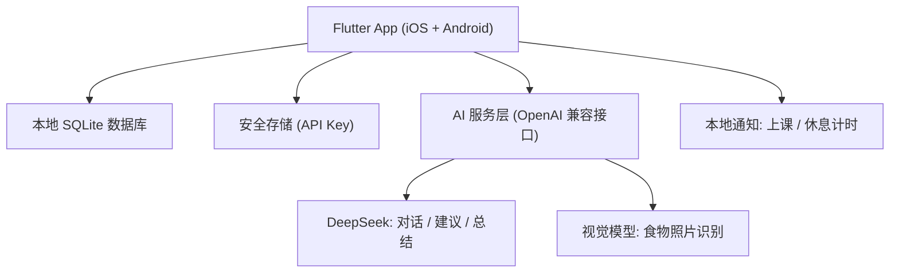

# 个人生活记录 App 功能需求报告

> 工作名：**LifeLog**（之后可以改）
> 目标：一个 App 管理**课表 + 饮食 + 健身 + 身体数据**，再用 **DeepSeek AI** 给个性化建议。

---

## 一、你提出的核心需求

| # | 需求 | 归入模块 |
|---|------|---------|
| 1 | 设置课表 | 课程表模块 |
| 2 | 记录每天吃什么 | 饮食模块 |
| 3 | 拍照估算热量 | 饮食模块（AI 识图） |
| 4 | 记录锻炼，每组的重量和次数 | 健身模块 |
| 5 | 根据身体数据给建议 | 身体数据 + AI 助手 |
| 6 | 内置 DeepSeek，或者用你自己的 API Key | AI 助手 / 设置 |

---

## 二、功能模块（含扩展）

图例：🟢 = 你提出的核心功能（MVP 必做）　🟡 = 建议扩展（第二期）　⚪ = 以后可选

### 1. 📅 课程表

| 功能 | 优先级 | 说明 |
|------|:---:|------|
| 周视图课表（按节次 × 星期） | 🟢 | 课程名、教室、老师、颜色 |
| 单双周 / 起止周 | 🟢 | 比如“第 1–16 周，单周” |
| 学期设置 | 🟢 | 开学日期，自动算出当前是第几周 |
| 上课提醒 | 🟡 | 提前 N 分钟发本地通知 |
| 今日视图 / 桌面小组件 | 🟡 | 首页直接看到今天的课 |
| 课表截图导入（AI 识别） | 🟡 | 拍一张教务系统截图，自动生成课表 |
| 作业 / 考试 / DDL 待办 | 🟡 | 挂在课程下面 |
| 课表空闲时段 → 推荐训练时间 | ⚪ | 和健身模块联动 |

### 2. 🍱 饮食记录

| 功能 | 优先级 | 说明 |
|------|:---:|------|
| 按餐记录（早 / 午 / 晚 / 加餐） | 🟢 | 食物名、份量、热量 |
| **拍照估算热量** | 🟢 | AI 识别食物 → 估算份量 → 热量和三大营养素 |
| 识别结果可手动修改 | 🟢 | AI 估算有误差，必须能改 |
| 每日热量目标和进度环 | 🟢 | 根据 TDEE 和目标（减脂 / 增肌 / 维持）自动算 |
| 三大营养素统计 | 🟢 | 蛋白质 / 碳水 / 脂肪（克数和占比） |
| 常用食物 / 收藏 / 一键复制昨天 | 🟡 | 减少重复输入 |
| 内置食物数据库 | 🟡 | 中国食物成分表常见食物，可以离线查 |
| 饮水记录 | 🟡 | 每天喝水目标 |
| 文字描述记录 | 🟡 | 输入“一碗牛肉面加个蛋”，AI 估算热量 |
| 条码扫描（包装食品） | ⚪ | 需要接第三方条码库 |

### 3. 🏋️ 健身记录

| 功能 | 优先级 | 说明 |
|------|:---:|------|
| 动作库 | 🟢 | 内置常见动作，按部位分类（胸 / 背 / 腿…），支持自定义 |
| **按组记录：重量 × 次数** | 🟢 | 每组可以标记为热身组 / 正式组 / 力竭 |
| 训练会话 | 🟢 | 开始 → 记录 → 结束，自动算时长和总训练量 |
| 历史记录 | 🟢 | 按日期查看 |
| 自动带出上次的重量 | 🟡 | 方便渐进超负荷 |
| 组间休息计时器 | 🟡 | 带震动提醒 |
| 训练模板 / 计划 | 🟡 | 比如推 / 拉 / 腿分化，一键开练 |
| 个人记录（PR）和估算 1RM | 🟡 | 破纪录时提醒 |
| 进步曲线 | 🟡 | 每个动作的重量和训练量趋势 |
| 有氧记录 | 🟡 | 跑步、骑行：时长、距离、消耗 |
| 部位训练热力图 | ⚪ | 看哪些肌群练少了 |

### 4. 📏 身体数据

| 功能 | 优先级 | 说明 |
|------|:---:|------|
| 基础资料 | 🟢 | 性别、年龄、身高、目标 |
| 体重记录和曲线 | 🟢 | 每天或每周记录 |
| BMR / TDEE 自动计算 | 🟢 | Mifflin-St Jeor 公式 + 活动系数 |
| 体脂率、围度（腰 / 胸 / 臂…） | 🟡 | 用于判断增肌还是长脂 |
| 体态照片对比 | 🟡 | 定期拍照，前后对比 |
| 睡眠、心情记录 | ⚪ | 拓展成完整的生活日志 |
| 接入 Apple 健康 / Health Connect | ⚪ | 自动同步步数、体重 |

### 5. 🤖 AI 助手（DeepSeek）

| 功能 | 优先级 | 说明 |
|------|:---:|------|
| AI 对话 | 🟢 | AI 能看到你的身体数据和最近记录，回答问题 |
| 每日 / 每周总结 | 🟢 | “本周平均摄入 2100 kcal，蛋白质偏低…” |
| 饮食建议 | 🟢 | 根据今天剩下的热量和营养素推荐吃什么 |
| 训练建议 | 🟡 | 根据历史训练量建议加重或减载 |
| 生成训练计划 | 🟡 | 结合课表的空闲时间生成每周计划 |
| 自定义 API Key 和模型 | 🟢 | 在设置里填 Key，可以切换模型 |

### 6. ⚙️ 通用

| 功能 | 优先级 | 说明 |
|------|:---:|------|
| 首页仪表盘 | 🟢 | 今天的课、热量进度、今日训练、体重 |
| 本地数据存储（离线可用） | 🟢 | SQLite |
| 数据导出和备份（JSON / CSV） | 🟡 | 防止丢数据 |
| 深色模式 | 🟡 | |
| 云同步 / 多设备 | ⚪ | 需要后端，增加复杂度 |

---

## 三、⚠️ 关键技术问题：DeepSeek 与拍照识别

> [!WARNING]
> **据我所知，DeepSeek 官方 API（`deepseek-chat` / `deepseek-reasoner`）目前只支持文字输入，不能直接识图。** 拍照估算热量需要视觉模型。开发前我会再查一次最新文档，确认它是否已经支持图片。

可选方案：

| 方案 | 做法 | 优点 | 缺点 |
|------|------|------|------|
| **A. 混合（推荐）** | 视觉模型识别“食物 + 份量”，DeepSeek 负责算热量、给建议、对话 | 各自做擅长的事；DeepSeek 便宜 | 需要两个 API Key |
| B. 全部用视觉模型 | 通义千问 VL / Gemini / GPT-4o 等包办所有 AI 功能 | 只需一个 Key | 不是 DeepSeek |
| C. 先文字后拍照 | 第一版用文字描述 + DeepSeek 估算，拍照之后再加 | 最快上线 | 第一版没有拍照功能 |

设计上会做成 **“兼容 OpenAI 格式的通用接口”**：设置里分别填【对话模型】和【视觉模型】的 Base URL、Key、模型名。这样 DeepSeek、通义千问、Kimi、Gemini 等都能随时切换。

### API Key 安全

> [!CAUTION]
> **不建议把 API Key 写死在 App 安装包里**，安装包可以被反编译，Key 被盗会产生费用。
> 推荐：由你在 App 设置里填写自己的 Key，存进系统安全存储（iOS Keychain / Android Keystore）。App 自己用的话这样最简单也最安全；以后要分发给别人，再加一个后端代理。

---

## 四、建议的技术方案

| 项目 | 选型 | 原因 |
|------|------|------|
| 框架 | **Flutter**（备选：React Native + Expo） | 一套代码同时出 iOS 和 Android，性能好，图表库成熟 |
| 数据库 | SQLite（drift） | 离线可用，数据在自己手机上 |
| 图表 | fl_chart | 体重、热量、训练量曲线 |
| 状态管理 | Riverpod | |
| AI | HTTP 调用 OpenAI 兼容接口 | 可切换任意模型 |

---

## 五、开发阶段规划

| 阶段 | 内容 | 产出 |
|------|------|------|
| **第一期 MVP** | 所有 🟢 功能：课表、饮食记录 + 拍照估算、健身按组记录、身体数据和 TDEE、DeepSeek 对话和总结 | 能日常使用的 App |
| 第二期 | 🟡 功能：模板、休息计时、PR、进步曲线、提醒、食物库、导出备份 | 体验完善 |
| 第三期 | ⚪ 功能：健康数据同步、云同步、小组件、课表截图导入 | 进阶 |

---

## 六、需要你确认的问题

1. **手机系统**：iPhone、安卓，还是两个都要？（iPhone 安装到真机需要 Mac + Xcode，或者 Apple 开发者账号）
2. **拍照识别方案**：选 A / B / C 哪一种？
3. **只给你自己用**，还是以后可能分享给别人？（决定要不要做后端）
4. **界面语言**：只要中文吗？
5. 上面扩展的功能里，有没有**不想要**的，或者还有**想加**的？
